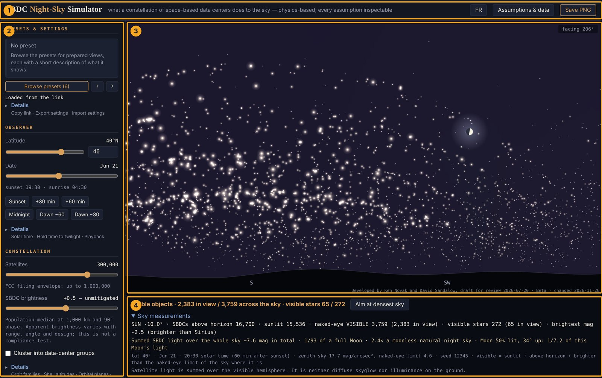

# SBDC Night-Sky Simulator — beta

*Developed by Ken Novak and David Sandalow, beta, 2026-11-26*

An interactive, physics-based simulation of how a very large constellation of space-based data centers (SBDCs) would appear in the sky — from any latitude, on any date, at any time of day. The scenario is grounded in the January 30, 2026 FCC filing: up to 1,000,000 satellites at 500–2,000 km, in Sun-synchronous and 30°-inclination shells.

This is the beta. It started on 2026-11-11 as a copy of the released simulator of 2026-07-20 and has changed since; the released simulator has not. The documents in this folder describe the beta. The released simulator's documents are in the parent folder and are unchanged.

| | Released | Beta |
| --- | --- | --- |
| Page | <https://knovak.github.io/siteprep/demos/SBDC%20Night%20Sky/> | <https://knovak.github.io/siteprep/demos/SBDC%20Night%20Sky/beta/> |
| Label at the end of the credit line | Released · changed *date* | Beta · changed *date* |
| Documents | `TUTORIAL.md`, `SPECIFICATION.md`, `FINAL_REPORT.md` of 2026-07-20 | `TUTORIAL`, `SPECIFICATION`, `BETA_REPORT` of 2026-11-26 |

## What the beta has that the released simulator does not

| Since | What |
| --- | --- |
| 2026-11-11 | Every setting can be exported to a text file, edited and imported again; presets are stored settings files |
| 2026-11-15 | A comparison with the `sdross0/orbital-datacenter-brightness` simulator found eight faults, now corrected, and led to five units of new work |
| 2026-11-15 | Plane layout, plane spread, brightness scatter and phase law are controls; latitude to a tenth of a degree; three presets for the sdross0 setups; a link that carries the settings |
| 2026-11-15 | The twilight sky corrected to measured values; ambient light by Bortle class; a choice of naked-eye threshold |
| 2026-11-15 | The Moon, with its phase and place, and the light it adds to the sky; SBDC light compared with a full Moon and with a natural night sky |
| 2026-11-15 | The hours of a night and of a year in which SBDC light is significant; a perspective view; "Aim at densest sky" |
| 2026-11-20 | An independent review, and its four packages of fixes: clustered satellites counted as objects, cancellable calculations, readable counts on a phone, saved images that record their settings |
| 2026-11-26 | Each group shows a few controls and keeps the rest under "Details"; presets have descriptions and a preset browser; the Moon is "As on this date" by default |

The twilight correction changes the numbers most. At the end of civil twilight the released simulator's sky was about 19 times darker than the measurements it cites, so it counted fourth-magnitude satellites as visible when only first-magnitude ones are. In the opening view the beta counts 546 visible SBDCs against 2 visible stars; the released simulator counted 3,290 against 67. An hour after sunset the two agree within about 15%.

## Using it

Open the beta page, or open **`sbdc-sky-simulator.html`** from this folder in any modern browser. It is a single self-contained file of about 460 KB: no installation, no internet connection.



1. **Top bar:** French or English, the Assumptions & data table, and Save PNG.
2. **Control panel:** six groups. Each shows up to three controls and keeps the rest under a Details section, which lists their names while it is closed.
3. **Sky:** drag to look around, scroll or pinch to zoom, hover a bright point to identify it.
4. **Readout:** the counts, the light of the constellation, and the sky's own brightness.

**Presets.** "Browse presets" lists every preset with a one- or two-sentence description, under its category, with a filter. Choosing one sets every control. The ‹ and › buttons step through the list. Six presets ship with the beta: three places (New York City, Taos, Alice Springs) and three setups of the sdross0 simulator.

**Saving and sharing.** Under the Details of "Presets & settings": **Copy link** puts every setting that differs from the defaults in the page address; **Export settings** saves a commented text file; **Import settings** reads one back. **Save PNG** saves the picture with its numbers, a build identifier and a settings reference in the caption, and the full settings inside the file.

**Keyboard.** With the sky focused, arrows pan, `+`/`−` zoom and Space plays or pauses.

## Auditing the physics

**Assumptions & data** lists the 47 parameters the model uses, in nine sections, each with its value, units, source and a confidence rating: 7 measured, 7 published, 13 modeled and 20 assumed. Satellite brightness is the least certain: the FCC filing gives no sizes or albedos, so the brightness is a slider and every rendered sky illustrates a scenario. To change an assumption, edit the `sbdc-data` block in the HTML file, or `data/sbdc-data.json` in the source and rebuild.

Simplifications: a spherical Earth, no refraction, circular orbits, local solar time as the clock (so longitude does not matter), Earth's penumbra ignored, and the Moon placed by taking solar time as universal time. The Moon is placed to within about 7° for any longitude.

## For developers

The source is `sbdc-sim-beta-source.zip` here, or the `initiatives/sbdc-night-sky/beta/` folder of the siteprep repository. From that folder:

```
node --test test/*.test.js     # 158 model, rendering, settings and preset tests
node build.js                  # inline everything -> dist/sbdc-sky-simulator.html
node build.js <directory>      # the same page as <directory>/index.html
npm run validate               # checks against external anchors
node tools/sensitivity.mjs     # how the hours results depend on sampling
node tools/make-golden.mjs     # refreeze the golden fixtures (intentional model changes only)
```

The repository's browser tests drive the published page in Chromium: `npx playwright test tests/e2e/sbdc-beta.spec.js --project=chromium` from the repository root, after `npm ci` and `npm run build` (36 tests).

Layout: `data/` (assumptions and the Yale Bright Star Catalog, 9,096 stars), `presets/` (one YAML settings file per preset), `src/model.js` (the physics, with no DOM), `src/render.js`, `src/settings.js` (the settings schema and file format), `src/format.js`, `src/ui.js`, `src/analysis-worker.js` (night and year calculations off the main thread), `build.js`. The build refuses a preset with a mistake or without a name and description.

The beta is published from the repository on every merge to `main`, after its tests pass. The repository's `beta/README.md` is the developer reference for each change; `PLAN.md` is the plan for the November 2026 upgrade.

## Before citing results

Two things the automated tests do not cover: a screen-reader session on a physical phone, and a domain review of the brightness assumptions before quoting any hours of significant light. `BETA_REPORT` lists them with what is already verified.
