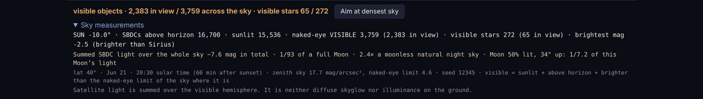
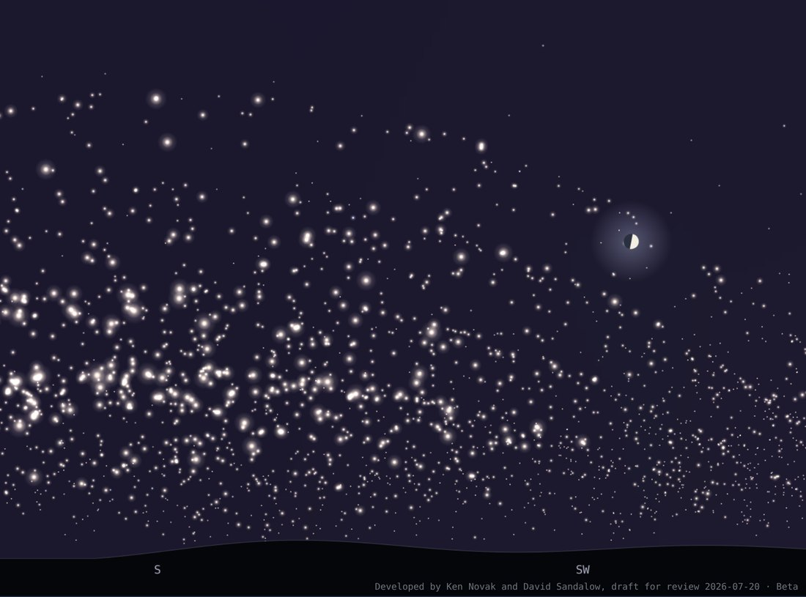
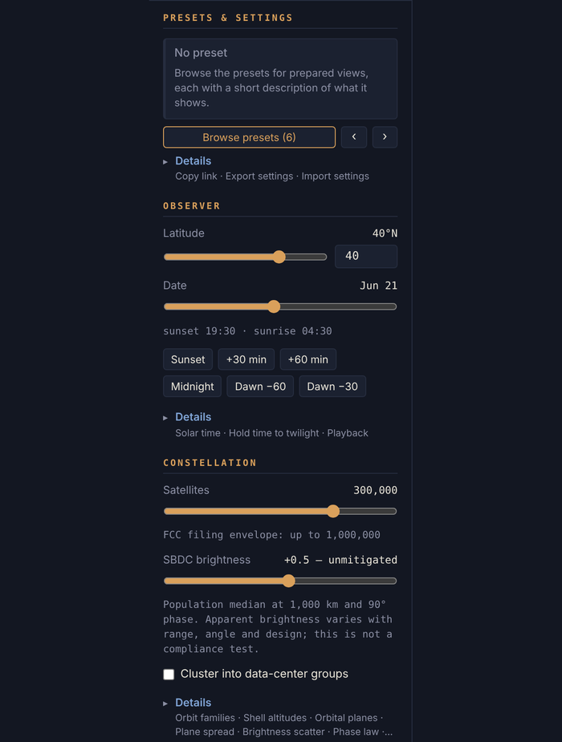
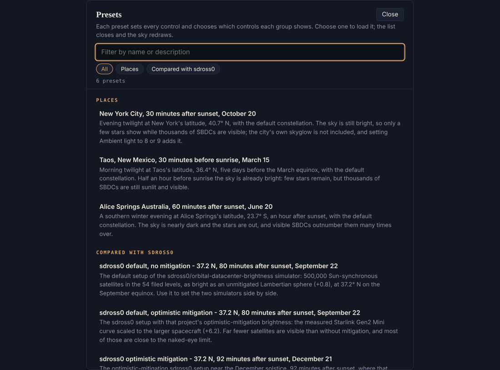
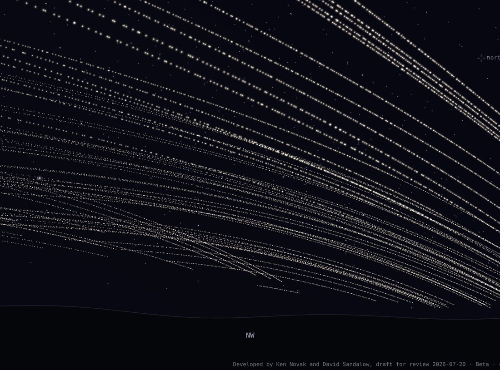
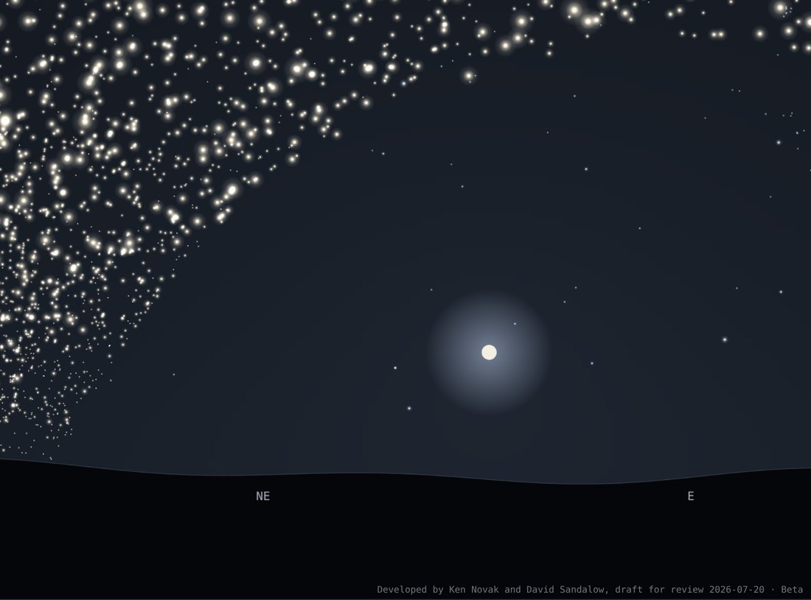
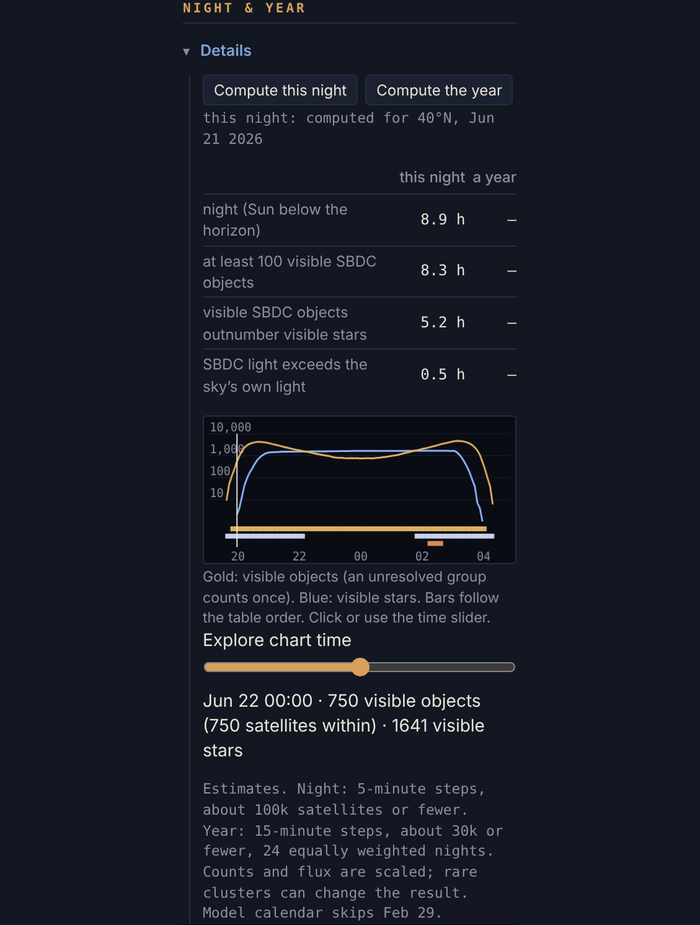

# SBDC Night-Sky Simulator — User Tutorial (beta)

*Developed by Ken Novak and David Sandalow, beta, 2026-11-26*

This tool shows what the sky would look like if a very large constellation of space-based data centers (SBDCs) were in orbit — from anywhere on Earth, on any date, at any time. It runs from a single file, `sbdc-sky-simulator.html`, entirely on your own device, or from the beta page at <https://knovak.github.io/siteprep/demos/SBDC%20Night%20Sky/beta/>.

Every number in this tutorial is what the beta shows with its default settings, changed only as described: 300,000 satellites, seed 12345, the Moon as on the date in 2026.

## Five minutes to the main story

Open the page. You are looking north from 40°N, with east on the right like a map, half an hour after sunset on the June solstice. The three lines under the sky say what you are seeing.

The headline reads **2 in view / 546 across the sky**, against **2 visible stars**. Of 22,523 satellites above the horizon, 22,013 are sunlit, but the sky is still bright — the Sun is 5.6° down — so only the brightest 546 show, and two of them are in the picture. Press **Aim at densest sky** beside the headline and the view turns to where most of them are.

Now press **+60 min**. The Sun is 10° down, the sky has darkened, and **3,759** SBDCs are visible across the sky against **272** stars; facing south-southwest, 2,383 of them are in the picture. This is the dusk swarm the report describes.

Press **Midnight**: **736** SBDCs against **1,641** stars. At local midnight you are as far from the day–night line as you can be, and most of the dawn–dusk swarm is below the horizon or in Earth's shadow. Press **Sunset**, **+30 min**, **+60 min** in turn to watch the band emerge as the sky darkens and then thin as Earth's shadow climbs. **▶▶ Fast forward** sweeps through the night continuously; **▶ Real time**, under the Observer group's Details, moves the satellites at their true speed against nearly still stars.

Then change the **Latitude**. Near the equator, half an hour after sunset, the band stands high and **11,269** SBDCs are visible against 64 stars. At 60°N on June 21 the Sun is only 6.6° below the horizon at midnight: 10,955 of the 11,251 satellites above the horizon are sunlit all night, but the twilight sky hides all but 13 of them from the eye. To keep "an hour after sunset" meaning an hour after *local* sunset while you move, tick **Hold time relative to sunset/dawn** under the Observer Details first.

## The control panel

The panel has six groups. Each shows up to three controls and keeps the rest under **Details**. A closed Details section lists the names of the controls inside it in small type, and in its tooltip; a click opens it. Night & year and Advanced show only their Details. A preset can choose which controls each group shows and whether its Details start open.

**Presets & settings** shows the preset in use with its description. **Browse presets** opens the list; **‹** and **›** load the previous and next preset without opening it. Under Details: **Copy link**, **Export settings** and **Import settings**.

**Observer** shows latitude (the box beside the slider takes tenths of a degree), date (with sunset and sunrise beneath it, or "polar day" and "polar night"), and the jump buttons: Sunset, +30 min, +60 min, Midnight, Dawn −60, Dawn −30. Under Details: the **Solar time** slider, the twilight hold, and playback. Solar time is local solar time: the Sun is highest at 12:00, and a clock can differ from it by an hour or more.

**Constellation** shows the satellite count (10,000 to 1,000,000, the filing's maximum; the default 300,000 is the report's "several hundred thousand"), **SBDC brightness**, and **Cluster into data-center groups**. Under Details: the split between Sun-synchronous and 30°-inclination orbits, shell altitudes (with the filing's 54 Sun-synchronous levels as one choice, and *Custom…* for `altitude:share` pairs), plane layout, plane spread, brightness scatter, phase law and launch trains.

**Sky & display** shows the view: **Horizon** (a panorama), **Perspective** (as a camera sees it, straight lines stay straight) or **All-sky fisheye** (zenith at the center). Under Details: the eye limit, **Ambient light** by Bortle class, the **Moon**, stars on or off, and the long-exposure camera.

**Night & year** and **Advanced** are described below.

## Presets

**Browse presets** lists every preset with a one- or two-sentence description. Type in the box to filter — every word has to appear in the name, the description or the category — or press a category button. The arrow keys move through the list and Enter loads a preset; Escape closes the list without loading anything. The preset in use is marked "loaded".

The beta has six. Three are places: New York City half an hour after sunset in October, Taos half an hour before sunrise in March, and Alice Springs an hour after sunset in the southern winter. Three reproduce the setups of the `sdross0/orbital-datacenter-brightness` simulator — 500,000 Sun-synchronous satellites in the 54 filed levels, at 37.2°N — with its "no mitigation" and "optimistic mitigation" brightness models. Those three have the Moon off, because that simulator has none.

Once you change a control, the card says which preset the settings started from. Opening a Details section is not a change.

## Looking around

Drag the sky to turn; scroll or pinch to zoom between a 20° close-up and a 140° panorama. The compass badge shows which way you face, and the hills carry the compass points. A small crosshair marks the **celestial pole**, which sits at an altitude equal to your latitude. Hover or tap a bright point: a satellite reports its orbit family, position, range, shell and magnitude; a cluster reports its members, size and combined magnitude; the brightest stars give their names. With the sky focused, arrows pan, `+`/`−` zoom and Space plays or pauses.

The **Perspective** view draws what a camera records and draws at most 120° across. With an sdross0 preset it can be set beside that simulator's pictures, which use the same projection.

## The assumptions that decide the picture

**SBDC brightness** is the most consequential slider. It sets the median magnitude of the population at a reference distance of 1,000 km, half lit and overhead, from −7 to +7. +0.5 is labelled "unmitigated", the large platform of the report's annex and the default; +5.5 is labelled "strong mitigation", roughly the darkening Starlink has demonstrated. It is a population median, not the brightness any one satellite has at your eye, so it is not a test against any guideline. An hour after sunset: +0.5 gives 3,759 visible, +5.5 gives 158, +7 gives 10.

**Phase law** sets how brightness changes with the angle between the Sun, the satellite and you: a diffuse sphere, or the measured curve of a mitigated Starlink Gen2 Mini, which brightens much more when the satellite is nearly between you and the Sun. **Brightness scatter** sets how much satellites differ from one another.

**Cluster into data-center groups** packs satellites into tight formations. A hundred individually faint satellites together make one bright object, so an hour after sunset the 3,759 visible points become **115** visible objects holding 12,562 satellites, the brightest at magnitude −5.5, brighter than Venus. The readout then counts objects, and says how many satellites they hold. The FCC filing says nothing about clustering; the toggle is there so the two architectures can be compared.

## What the sky is compared against

**Ambient light** adds artificial skyglow by Bortle class, 1 (none) to 9 (inner city). At class 8 an hour after sunset, 3,187 SBDCs and 161 stars are visible, against 3,759 and 272 at class 1.

**Moon** is "As on this date" by default: the Moon where it is on that date and solar time in the year given, with its phase, and the light it adds to the sky near it. "Set the phase" gives a Moon of a chosen age on any date; "Off" removes it. On December 24, 2026, two hours after sunset, a full Moon 14° up cuts the visible SBDCs from 23,579 to 19,360 and the visible stars from 1,730 to 685.

**Eye limit** is the faintest magnitude this observer sees under a dark sky, 4.0 to 6.5. **Naked-eye threshold**, under Advanced, chooses how sky brightness sets the faintest magnitude seen: the simulator's table, which matches when stars are seen to appear in twilight, or the Schaefer formula used by the sdross0 project, which is stricter under a bright sky (2,638 visible an hour after sunset, against 3,759).

## Reading the numbers

The **headline** gives the visible count in the picture and across the whole sky, and the same for stars. The two answer different questions: turning or zooming changes the first and not the second.

The **first line** separates three things. *Above horizon* is geometry. *Sunlit* removes satellites in Earth's shadow. *Visible* is the naked-eye test: a satellite or star counts only if it is brighter than the limit of the sky where it is. The brightest magnitude comes with a plain anchor such as "brighter than Sirius". Magnitudes run backwards: −4 is brilliant, +6 is the faintest a perfect eye sees.

The **light line**, in a warmer color, adds up the light of every sunlit SBDC above the horizon, including the ones too faint to see one by one, and compares it with a full Moon overhead, with the whole moonless night sky, and with the Moon as it is. In the opening view the total is −7.8 mag: 1/79 of a full Moon, 2.8 times a moonless natural night sky, and 1/6.3 of the half-lit Moon then up. It is light summed over the hemisphere, not a brightening of the sky at any one point.

The **sky line** gives the latitude, date, solar time and its distance from sunset or sunrise, the sky's brightness overhead and the naked-eye limit it allows, and the seed.

## Night & year

**Compute this night** works through the chosen date in five-minute steps and reports, beside the length of the night, the hours in which at least 100 SBDCs are visible, in which visible SBDCs outnumber visible stars, and in which the summed SBDC light exceeds the sky's own light. For the opening view: a night of 8.9 hours, 8.3 hours with at least 100 visible, 5.2 hours outnumbering the stars, and 0.5 hours exceeding the sky. **Compute the year** samples 24 dates. A click on the chart, or the chart-time slider, moves the sky to that moment. When a setting changes, the results are dimmed until they are computed again.

These are estimates: the calculation thins the constellation and samples time, and the third row depends on the brightest few percent of satellites. Quote them with their settings.

## Advanced

The **seed** makes any sky reproducible: the same settings and seed give the same picture. **Tint by orbit family** colors the two families for analysis. **Mark celestial pole** switches the crosshair. **Satellites move in fast forward** switches the shimmer of fast-forward playback. The cluster variation sliders set how much clusters differ from one another.

## Saving and sharing

**Save PNG** saves the picture with the readout, the build and a settings reference in its caption, and the complete settings inside the file. **Copy link** puts the settings in the page address, so the person you send it to sees the same sky. **Export settings** writes a commented text file that can be edited and loaded again with **Import settings**. **FR** switches the interface to French; the assumptions table, the presets and messages about settings files stay in English.

## Limitations and assumptions you should know about

**The satellite brightness is an assumption.** The FCC filing says nothing about sizes, coatings or orientations. Every rendered sky illustrates a scenario; it is not a photometric prediction. The geometry is solid; the brightness is a stated, adjustable assumption.

**The constellation arrangement is invented within the filing's envelope.** The filing bounds the totals, the altitudes and the two inclination families. The shell mixes, plane layouts and clustering are plausible arrangements, not the operator's plan.

**Simplifications:** a spherical Earth, no refraction, circular orbits, Earth's penumbra ignored. The clock is local solar time, so longitude does not matter; the Moon is placed by taking solar time as universal time, which puts it within about 7° of its true place for any longitude. The camera mode draws each trail as a straight 30-second chord and records satellites to magnitude 9. On a phone the sky scrolls up with the page; it is not pinned.

**Every number behind the simulation is inspectable.** **Assumptions & data** lists 47 parameters with units, sources and a confidence rating — 7 *measured*, 7 *published*, 13 *modeled* and 20 *assumed*. The assumed rows are the ones to probe, and the tool makes probing them a slider.

**What it does not do:** it does not track real satellites, model radio or thermal effects, or simulate collisions and debris. It answers one question: *what would this look like?*
