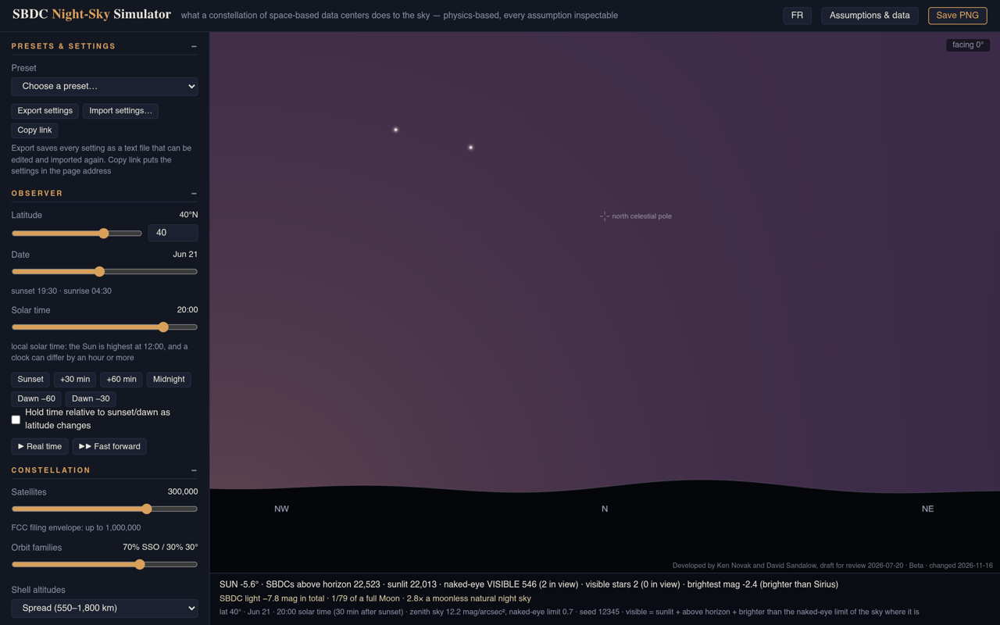
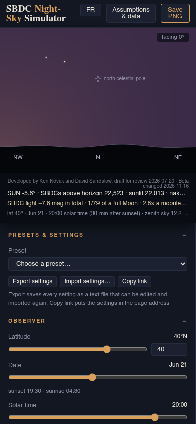
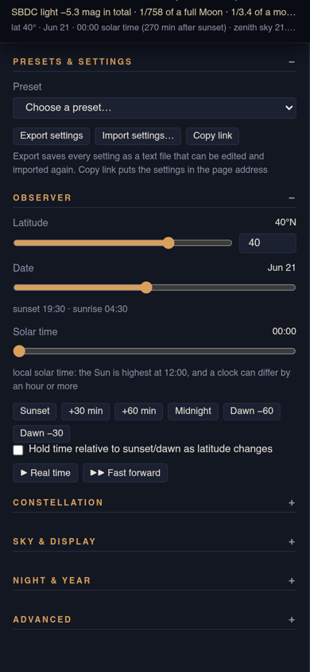

# SBDC Night-Sky Simulator: beta evaluation

**20 November 2026 · [Hosted beta](https://knovak.github.io/siteprep/demos/SBDC%20Night%20Sky/beta/) · [Source reviewed](https://github.com/knovak/siteprep/tree/2c29c4c5d7188aa15d73a67126b749891f133e12/initiatives/sbdc-night-sky/beta)**

This is the **before-change assessment**. See the [implementation and verification record](beta-audit-implementation-2026-11-20.md) for the fixes, measured results and remaining acceptance work.

**Verdict:** Keep the beta for exploring *what changes when an assumption changes*. Do not quote its clustered “outnumber stars” hours, interpret the brightness slider as meeting IAU guidance, or present its annual hours as observational predictions. Three small, reproducible examples below explain why. The most valuable next upgrade is to make the existing answers trustworthy and readable, not to add another control.

## Fix order

P1 means a result can mislead or a core task is inaccessible. P2 means a material limitation with a workaround, or an estimate that needs qualification. P3 is useful follow-up. Within each tier, items are in recommended order.

| Rank | Finding | Recommended change / evidence of completion |
| --- | --- | --- |
| 1 · P1 | **Cluster members are compared with individual stars.** Three unresolved points containing 300 satellites were reported as outnumbering 44 stars. | Use visible **objects** for visual competition, visible **satellites in those objects** for inventory. Test both side by side in the chart, threshold rows, and instant readout; unclustered results must not change. |
| 2 · P1 | **“+7 = IAU target” compares different magnitudes.** The slider sets a population median at 1,000 km, not apparent brightness at the observer. | Remove the badge in English and French. If showing a guidance comparison, calculate it per shell, label the geometry and distribution, and show it separately from the slider. |
| 3 · P1 | **A year computed for 40°N can be labeled 15°N.** Changing latitude during a run changes the completed label but not the calculation. | Capture label and inputs together. Either cancel on edits or retain the old result with its original latitude and its own stale marker. Test a change after the first sampled date. |
| 4 · P1 | **Night analysis freezes other controls.** A single main-thread task occupied 822 ms on desktop and 3,409 ms under 4× CPU slowdown. | Make analysis cancellable and run it off the UI thread or in short slices. Confirm that pan, stop, and changing a setting still respond while it runs. |
| 5 · P1 | **Phones hide the headline answer.** At 390 px the line ends before the count labeled “naked-eye visible.” | Show “2 in view · 546 across the sky” first, with stars beside it; wrap or disclose the remaining figures. All answers must be reachable without sideways scrolling, in both languages at 320 and 390 px. |
| 6 · P1 | **Keyboard activation changes the simulation unexpectedly.** Space on “Assumptions & data” starts fast-forward; Tab can move behind the open dialog. | Scope shortcuts to the focused sky; use a modal that takes, contains, and restores focus and closes on Escape. Verify native buttons and disclosures still respond to Space and Enter. |
| 7 · P2 | **“This night” does not advance the calendar at midnight.** The chart joins an evening to the *preceding* morning, significant when the dated Moon is on. | Advance the date for the morning half and for continuous playback, including year rollover, or explicitly label this as a fixed-date composite. Test lunar phase on both sides. |
| 8 · P2 | **Estimated hours look more precise than the sampling.** A 75-minute light-exceedance result became 57.5 minutes with a finer calculation of the same scenario. | Show method and resolution next to the result; test convergence across seeds, seasons, latitudes and clustering. Compare unrounded flux ratios at the threshold; round for display only. |
| 9 · P2 | **The camera and total-light captions invite the wrong interpretation.** The camera does not draw every sunlit satellite or guarantee a 12–27° trail; a whole-sky flux ratio is not a brightening factor at every point. | Describe what the camera selects and label the ratio “summed satellite light over the whole sky.” Say explicitly that this is neither diffuse skyglow nor ground illuminance. |
| 10 · P2 | **The validation narrative can contradict its own output.** A run reports 425 visible, then concludes “thousands.” | Generate comparisons from measured values. Separate regression, cross-model agreement and validation against observation; include a sourced observed case with stated geometry and tolerance. |
| 11 · P3 | **The first view and exported images lack context.** Two dots look like an empty simulation; saved PNG captions use a fixed July draft credit, not the beta build identity. | Offer the existing “Aim at densest sky” or “All-sky” beside the in-view count. Stamp exports with the channel/version and settings reference. Keep the agreed opening time; do not assume a sticky phone sky is wanted. |

## What a visitor sees

**Desktop, 1440 × 900.** On June 21 at 40°N, 20:00 solar time, the cloud browser showed **22,523 above the horizon → 22,013 sunlit → 546 naked-eye visible → 2 in view**. The two stars visible across the sky were both outside the frame. The distinction is scientifically useful; the interface makes the reader find it at the end of a long line. Moving the existing aim action here would explain the sparse view without changing it.

| Phone opening | After selecting Midnight |
| --- | --- |
|  |  |

**Phone, 390 × 844.** The control worked: solar time changed from 20:00 to 00:00, and the light ratio changed from 1/79 to 1/758 of a full Moon. The sky was no longer in the viewport, and the clipped text had no expansion control. In local Chromium the midnight count line needed **1,272 px in a 362 px box**, although the page itself correctly stayed 390 px wide. WebKit reproduced the clipping. The earlier width fix was valuable; do not undo it. A separate “Back to sky” control can be tested without committing to sticky positioning.

**Keyboard path.** Focus the assumptions button, press Space: playback starts, dialog stays closed. Stop playback and press Enter: the dialog opens, but Tab reaches the background “Save PNG” button, and Escape leaves the dialog open. The chart also offers pointer-only time selection; provide a keyboard equivalent and a readable data summary. Keep live announcements for deliberate changes, not every playback tick. See [`ui.js`, shortcut and dialog handlers](https://github.com/knovak/siteprep/blob/2c29c4c5d7188aa15d73a67126b749891f133e12/initiatives/sbdc-night-sky/beta/src/ui.js#L1118) and the [W3C modal dialog pattern](https://www.w3.org/WAI/ARIA/apg/patterns/dialog-modal/).

## Checks on the science

| Probe | Result | Interpretation |
| --- | --- | --- |
| **Count units.** Seed 12345; 10,000 satellites; no trains; groups of 100, 0.1 km diameter, both cluster spreads zero; 40°N, June 21, 20:15 solar; otherwise model defaults. | `summarize`: **3 visible objects, 300 members, 44 stars**. `sampleInstant` returns 300; both “at least 100” and “outnumber stars” are true. By points of light, both are false. | The instant model already has the right distinction. Carry it through [sampling and thresholds](https://github.com/knovak/siteprep/blob/2c29c4c5d7188aa15d73a67126b749891f133e12/initiatives/sbdc-night-sky/beta/src/model.js#L1201). The [renderer](https://github.com/knovak/siteprep/blob/2c29c4c5d7188aa15d73a67126b749891f133e12/initiatives/sbdc-night-sky/beta/src/render.js#L525) also paints compact knots by member magnitude and position; verify one properly bright point per unresolved knot, not just the count. |
| **Magnitude reference.** At the slider’s +7 setting, use a median member, 90° phase, overhead at 550 km. | The [range law](https://github.com/knovak/siteprep/blob/2c29c4c5d7188aa15d73a67126b749891f133e12/initiatives/sbdc-night-sky/beta/src/model.js#L643) gives `7 + 5 log10(550/1000) = +5.70`: **3.31× the flux** of an apparent +7 source. Above 550 km the guidance itself changes with altitude. | A valid reference-magnitude slider is not a compliance test. A median cannot guarantee the brightness of every member or orientation. [IAU CPS original recommendation](https://cps.iau.org/documents/44/Consolidated-CPS-Recommendations.pdf). |
| **Moon against an independent ephemeris.** June 21, 2026, 40°N, sea level, about 20:00 apparent solar time. | Beta: altitude **38.24°**, azimuth **222.53°**, illumination **49.31%**. JPL at 0° longitude, 20:02 UTC: **38.14°, 222.73°, 49.22%**. At 150°E, 10:02 UTC: **37.86°, 229.17°, 44.85%**. | Good agreement in the reference case; without longitude, do not imply a precise local lunar ephemeris. In the model at 04:00, June 21 and June 22 are **42.37% vs 52.73%** illuminated. That difference is lost in the fixed-date night. These two locations are spot checks, not error bounds. [JPL Horizons](https://ssd.jpl.nasa.gov/horizons/manual.html), target 301, observer coordinates, quantities 4 and 10. |
| **Convergence.** Seed 12345, nominal 300,000 plus default train, 40°N, June 21, Moon off. Compare the annual per-night method, the ordinary night method, and a denser reference for that date. | At ~30k members/15 min, ~100k/5 min, and full population/2.5 min: satellites outnumbered stars for **315 / 315 / 315 min**, but light exceeded sky for **75 / 75 / 57.5 min**. | Sensitivity depends on the metric. The denser run is not ground truth; both time step and sampling changed. Vary each separately next. The annual calculation weights **24 dates** to represent 365 days; do not extrapolate this one discrepancy to a yearly error bar. [Sampling and year weights](https://github.com/knovak/siteprep/blob/2c29c4c5d7188aa15d73a67126b749891f133e12/initiatives/sbdc-night-sky/beta/src/model.js#L1169). |
| **Camera trail claim.** Same model scenario at 20:00. Measure great-circle distance between the start and end of a 30-second exposure for sunlit sources within the camera magnitude limit and above the horizon at both endpoints. | **16,960 eligible trajectories; 1.51–10.88°, median 3.98°** across the hemisphere, before viewport and contrast filtering. None reached the caption’s 12° lower bound. | The [camera renderer](https://github.com/knovak/siteprep/blob/2c29c4c5d7188aa15d73a67126b749891f133e12/initiatives/sbdc-night-sky/beta/src/render.js#L491) also drops faint strokes and skips segments with both endpoints offscreen. Replace the fixed range with “length depends on distance and motion”; test a segment crossing the frame with both ends outside. |

**What is sound, and what is not established.** Keep the seeded scenarios, offline single-file distribution, separate above-horizon/sunlit/visible counts, measured twilight reference, and confidence-tagged assumptions. [Patat et al.](https://doi.org/10.1051/0004-6361:20064992) measured twilight at Paranal; that is a meaningful anchor, not a measurement at every simulated location. The filing does not supply platform photometry. Show the effect of changing brightness and scattering assumptions before treating a count as an observational forecast. The [existing decision](https://github.com/knovak/siteprep/blob/2c29c4c5d7188aa15d73a67126b749891f133e12/initiatives/sbdc-night-sky/decisions.md#L348) explicitly defines the light ratio as summed apparent flux; fix the wording rather than silently changing the quantity.

## Responsiveness and implementation

| Published HTML, measured locally | Observed time | What it measures |
| --- | --- | --- |
| Time jump, nominal 300k | **71–78 ms to dusk; 41–51 ms to midnight** | Three warm repeats per destination, button dispatch to the next frame after the readout changed. |
| Time jump, nominal 1M | **170–179 ms to dusk; 95–105 ms to midnight** | Same desktop, same sequence. Not end-user field latency. |
| Compute this night, nominal 300k | **0.85 s elapsed; 0.82 s longest main-thread task** | Default night, one desktop run. At a 390 px viewport with 4× CPU slowdown: **3.43 s elapsed; 3.41 s longest task**. Not a physical phone measurement. |
| Compute year, nominal 300k | **5.10 s elapsed** | One desktop run with a latitude edit after date 1/24. Progress continued; final label used the new latitude for the old result. |

The [frame update](https://github.com/knovak/siteprep/blob/2c29c4c5d7188aa15d73a67126b749891f133e12/initiatives/sbdc-night-sky/beta/src/ui.js#L352) already computes orbital visibility, star positions and star visibility. [The summarizer](https://github.com/knovak/siteprep/blob/2c29c4c5d7188aa15d73a67126b749891f133e12/initiatives/sbdc-night-sky/beta/src/model.js#L1118) computes all three again. First derive the picture and counts from one immutable evaluation, and compare results to existing fixtures. Then isolate the [night/year jobs](https://github.com/knovak/siteprep/blob/2c29c4c5d7188aa15d73a67126b749891f133e12/initiatives/sbdc-night-sky/beta/src/ui.js#L627); a timeout before a long loop does not make that loop interruptible. The annual job yields once per date and can be superseded by a new run, useful behavior worth keeping. Measure again before changing rendering technology. A [browser long task](https://web.dev/articles/optimize-long-tasks) starts at 50 ms.

**Code consistency.** The split between the pure model, renderer, settings format, and UI makes these faults testable. The weak boundary is between them: `visible` changes meaning, display rounding feeds the “exceeds” test (`>= 1`), and job labels are reconstructed from live controls. Prefer explicit fields (`visibleObjects`, `visibleMembers`, raw flux ratio, captured observer) over another general UI rewrite. Keep the deterministic regression and cross-model tests. The [validation script](https://github.com/knovak/siteprep/blob/2c29c4c5d7188aa15d73a67126b749891f133e12/initiatives/sbdc-night-sky/beta/tools/validate.mjs) is explicitly narrative: at 1M it printed **35,707 → 425** when changing +0.5 to +5.5, yet its fixed commentary still said thousands remained. Calculate the commentary from the output and keep physical validation separate from repeatability.

## Next steps for the initiative

These are proposed **beta-only** increments, not release approval or a change to the initiative’s dormant status. No implementation depends on resolving the deferred sticky-sky decision.

| Order | Work package | Acceptance gate |
| --- | --- | --- |
| **A · Correct the claims** | Model + copy: ranks **1, 2**, and the inexpensive caption corrections in **9, 10**. | The 3/300/44 case is unambiguous in English and French; unclustered fixtures still pass; the +7 counterexample and camera range no longer contradict the UI. |
| **B · Protect results and inputs** | Computation: ranks **3, 4**. Capture inputs; share the frame evaluation; make long jobs yield or move them off-thread. | Both labels and values match the starting location, or the job explicitly cancels. On the same 4× profile a cancel or pan produces feedback within **200 ms** during analysis; report timings and preserve numerical results. |
| **C · Make the answer accessible** | Interaction: ranks **5, 6**, then the opening-view part of **11**. Can run independently of B after units are named. | At 320/390 px and 200% zoom the whole-sky and in-view answers are readable; keyboard-only users open and close the assumptions, reach the chart’s time function, and never start playback by activating a button. Verify on a real phone and with a screen reader. |
| **D · Qualify estimates before external use** | Science and QA: ranks **7, 8**, observed validation in **10**, and export provenance in **11**. | Add midnight/year rollover and polar-day/night cases; publish a sampling-sensitivity table and a geometry-matched observational fixture. Exports identify the settings and build. Obtain separate approval for any production release. |

## Audit trail and limits

- **Version:** The live page returned HTTP 200 and displayed “Beta · changed 2026-11-16.” Its SHA-256 was `b484c86274ee6dc1f26c943b9ee02340128af8beb63fb796596af58973375dc8`. Rebuilding the reviewed source produced the same application; the diff was the build-injected channel stamp. The released simulator was not assessed or modified.
- **Hosted browser:** Microlink rendered the public URL with JavaScript at 1440 × 900 and 390 × 844 and activated Midnight on the phone layout. Figures above are its screenshots, not HTML placeholders or a local reconstruction. Controlled timings, keyboard steps and the latitude edit used the downloaded published page in local headless Chromium 143 on macOS ARM64, not cloud or field performance. Local WebKit 26 also completed the phone flow. Firefox did not launch in this environment; no Firefox, physical-device, or assistive-technology pass is claimed.
- **Recheck:** From `initiatives/sbdc-night-sky/beta`, run `npm test` (148/148 in this audit) and `npm run validate`; the latter prints commentary, not assertions. The numerical probes above use the exported functions in `src/model.js` and the checked-in JSON data/catalog. The [browser suite](../../../tests/e2e/sbdc-beta.spec.js) covers existing flows such as presets, Moon links, aim, and phone page width; page width alone does not prove that the text inside it fits.
